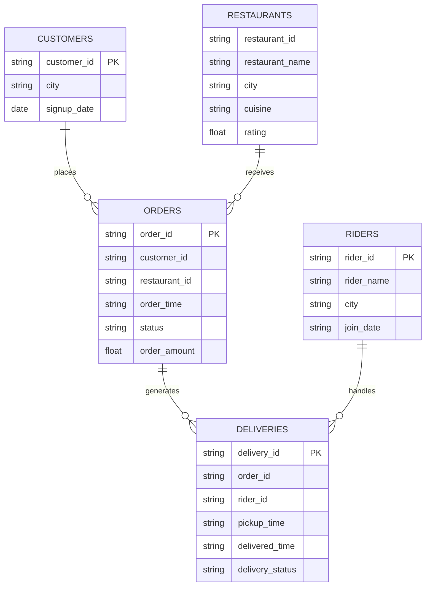

Food Delivery Operations Analysis Using SQL
An end-to-end SQL portfolio project exploring customer ordering behavior, restaurant performance, order revenue, and delivery operations in a food delivery business.

The project uses a relational database designed in MySQL Workbench and analyzes how customers, restaurants, orders, riders, and deliveries connect to support everyday business decisions.
Project Objectives
- Understand order volume, revenue, and average order value.
- Identify high-performing restaurants, cuisines, and cities.
- Explore customer ordering patterns and repeat activity.
- Assess rider workloads, delivery completion, and delivery time.
- Identify operational issues such as cancellations and delayed deliveries.
Tools & Skills
Tool / Skill	Application
MySQL	Relational data analysis with SQL queries
MySQL Workbench	Database modeling and ER diagram design
SQL JOINs	Combining orders with customer, restaurant, rider, and delivery data
Aggregations	COUNT(), SUM(), AVG(), and GROUP BY
Data validation	Checking missing values, duplicate IDs, and relationship integrity

Database Overview
The supplied MySQL Workbench model (second.mwb) contains five tables in the food_delivery schema.
Table	Primary key in model	Main fields	Purpose
customers	customer_id	city, signup_date	Customer location and signup information
orders	order_id	customer_id, restaurant_id, order_time, status, order_amount	Customer purchases and order amounts
restaurants	Not defined in model	restaurant_id, restaurant_name, city, cuisine, rating	Restaurant details and performance attributes
riders	rider_id	rider_name, city, join_date	Delivery partner information
deliveries	delivery_id	order_id, rider_id, pickup_time, delivered_time, delivery_status	Delivery assignments, progress, and timing

ER Diagram
The following diagram shows the intended analytical connections between tables, based on their shared ID fields. It is a conceptual view; not every connection is enforced as a foreign key in the supplied Workbench model.

Relationship Guide
Join	Join condition	Business meaning
Customers → Orders	customers.customer_id = orders.customer_id	Identify who placed an order
Restaurants → Orders	restaurants.restaurant_id = orders.restaurant_id	Find the restaurant receiving an order
Orders → Deliveries	orders.order_id = deliveries.order_id	Connect orders to their deliveries
Riders → Deliveries	riders.rider_id = deliveries.rider_id	Identify who handled each delivery

Modeling note: In the supplied .mwb file, orders also contains Workbench-created fields such as riders_rider_id, deliveries_delivery_id, and customers_customer_id, with foreign keys pointing from orders to those tables. Meanwhile, restaurant_id has no declared primary key, and the expected join columns above are not all defined as foreign keys. The diagram above presents the simpler business-level relationships for analysis; the physical model should be normalized and its constraints reviewed before deployment.
Business Questions
The database can be used to investigate:
1. How many orders were placed, and what was the total order amount?
2. How do monthly order volume and revenue change over time?
3. What is the average order value?
4. Which restaurants generate the highest order revenue?
5. Which cuisines and cities receive the most orders?
6. Which customers place the most orders?
7. What percentage of orders are completed or cancelled?
8. How many deliveries are completed by each rider?
9. What is the average time between pickup and delivery?
10. Which riders or locations show longer delivery times?
These are analysis objectives, not reported findings. Actual results require running SQL queries against the dataset.
Recommended Data Validation
Before calculating performance metrics:
- Check for duplicate customer_id, order_id, delivery_id, and rider_id values.
- Check missing values in identifiers, statuses, timestamps, and order amounts.
- Validate whether every order's customer and restaurant IDs exist in their source tables.
- Check whether each delivery references an existing order and rider.
- Convert text-based date/time columns into appropriate SQL temporal types where possible.
- Check that delivered timestamps do not precede pickup timestamps.
- Avoid double-counting order amounts when joining orders to multiple delivery records.
Analytical Approach
1. Understand the schema: Review tables and relationships using the Workbench ER diagram.
2. Validate the dataset: Check IDs, missing data, date formats, and relationship consistency.
3. Join relevant tables: Build customer, restaurant, order, and delivery views for analysis.
4. Calculate KPIs: Derive order counts, revenue, average order value, cancellation rates, and delivery durations.
5. Translate findings into decisions: Identify opportunities to improve operations and customer experience.
Business Applications
Analysis area	Potential business use
Revenue & order trends	Monitor demand and identify busy periods
Restaurant performance	Support restaurant partnerships and operational planning
Customer behavior	Understand customer engagement and repeat ordering
Rider efficiency	Monitor workloads and delivery throughput
Delivery status & time	Identify process bottlenecks and service issues

Project Files
- second.mwb — MySQL Workbench database model and ER diagram (upload this file alongside the README).
- SQL query files — Add your analysis .sql files to the repository when ready.
- Source CSV files — Add the five datasets if they are suitable for public sharing.
Learning Outcomes
This project demonstrates relational database understanding, SQL joins and aggregations, operational KPI design, data quality checks, and the ability to turn raw food delivery records into business-focused analysis.
Project by Riya Jain · SQL Data Analytics Portfolio
